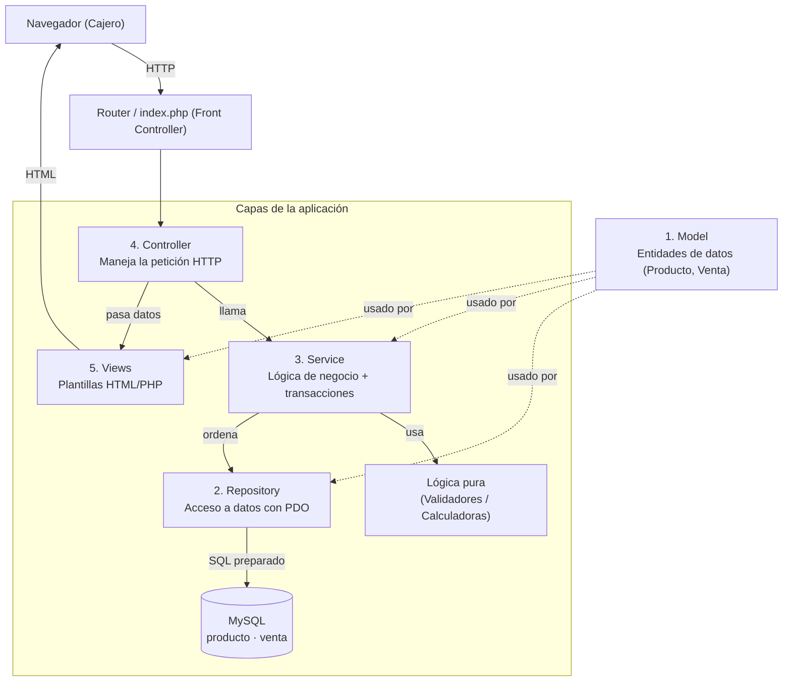
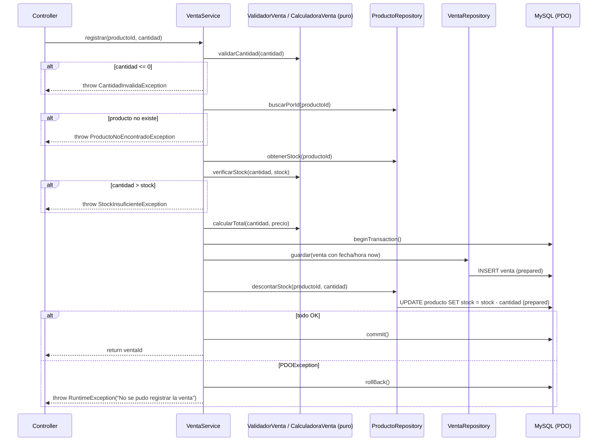

# Documento de Diseño — Sistema de Gestión de Ventas e Inventario del Minimarket "La Esquina"

## Overview

Este documento describe el diseño técnico del Sistema de gestión de ventas e inventario para el minimarket **"La Esquina"**. El sistema es una aplicación web interna, usada por una sola persona (el Cajero), que reemplaza el cuaderno de papel y la inspección visual de los estantes.

El sistema resuelve dos problemas concretos:

- **No saber cuánto se vendió en el día.** Hoy las ventas se anotan a mano y sumarlas es lento y propenso a errores.
- **Que los productos se agoten sin aviso.** No existe un mecanismo que avise cuando un producto baja de un stock mínimo.

Para ello, el sistema permite al Cajero: registrar productos (RF-1), listarlos con marca visual de stock bajo (RF-2), registrar ventas calculando el total y descontando stock de forma atómica (RF-3), y consultar las ventas del día actual con total acumulado (RF-4).

### Decisiones de diseño y su justificación

| Decisión | Justificación |
|---|---|
| **PHP 8 orientado a objetos, sin frameworks** | El minimarket ya usa XAMPP. PHP puro con tipado evita la curva de aprendizaje y dependencias externas de un framework, cumpliendo RNF-1 y RNF-2. |
| **MySQL con PDO y consultas preparadas** | PDO permite consultas preparadas que previenen inyección SQL (RNF-7) y maneja transacciones para garantizar la atomicidad de la venta (RN-5, RNF-6). |
| **Arquitectura en 5 capas** | Separa datos, acceso a BD, lógica de negocio, manejo de peticiones y presentación. Cada capa tiene una responsabilidad clara, lo que facilita el mantenimiento y las pruebas. |
| **Money como DECIMAL(10,2) en BD y `float` redondeado a 2 decimales en PHP** | Suficiente para un minimarket. Se redondea con `round($x, 2)` para evitar acumular errores. (Nota: para volúmenes altos se recomendaría operar en centavos como enteros, pero está fuera del alcance.) |
| **Lógica de validación/cálculo como funciones puras** | Permite testear las reglas de negocio (RN-1 a RN-5) con pruebas basadas en propiedades (PBT) sin depender de la base de datos. |

### Cumplimiento de requisitos

- **RF-1** (Registrar producto): cubierto por la capa Service + Repository, con validación pura (precio ≥ 0, stock ≥ 0, campos obligatorios, código único).
- **RF-2** (Listar y marcar stock bajo): cubierto por `Producto::esStockBajo()` y la vista.
- **RF-3** (Registrar venta): cubierto por `VentaService::registrar()` con cálculo de total, guardado de fecha/hora, descuento de stock y transacción atómica.
- **RF-4** (Consultar ventas del día): cubierto por `VentaService::consultarDelDia()`.
- **RN-1 a RN-5**: validados en la capa Service / funciones puras y reforzados con restricciones CHECK en la BD.

---

## Architecture

El sistema sigue una **arquitectura en 5 capas**. La petición del navegador entra por el Controlador, baja hasta el Repositorio (que habla con MySQL) y sube de vuelta hacia la Vista. La lógica de negocio vive en la capa Service, desacoplada tanto de la BD como del HTTP.



### Descripción de cada capa

#### Capa 1: Model (Entidades de datos)

**Qué es:** Clases que representan los datos del dominio: `Producto` y `Venta`. Son contenedores de datos con tipos, con sus getters/setters y métodos derivados puros (sin efectos secundarios), como `Producto::esStockBajo()`.

**Qué hace:**
- Guardar el estado de un producto o de una venta.
- Exponer métodos derivados puros (cálculos basados solo en sus propios datos).

**Qué NO debe hacer:**
- No accede a la base de datos.
- No conoce PDO ni SQL.
- No valida reglas que involucren a otras entidades o al estado del sistema.
- No conoce HTTP ni la vista.

#### Capa 2: Repository (Acceso a datos)

**Qué es:** Clases que encapsulan toda la interacción con MySQL usando PDO y consultas preparadas: `ProductoRepository` y `VentaRepository`.

**Qué hace:**
- Ejecuta `INSERT`, `SELECT`, `UPDATE` con consultas preparadas (parámetros enlazados).
- Convierte filas de la BD en objetos `Model` y viceversa (mapeo).
- Expone operaciones atómicas de lectura/escritura.

**Qué NO debe hacer:**
- No contiene reglas de negocio (no decide si una venta es válida).
- No maneja la petición HTTP ni conoce la vista.
- No gestiona el límite de la transacción (eso lo decide el Service que orquesta varias operaciones); solo ejecuta las sentencias sobre la conexión compartida.

#### Capa 3: Service (Lógica de negocio)

**Qué es:** Clases que implementan las reglas de negocio y orquestan a los repositorios: `ProductoService` y `VentaService`. Además, incluye **funciones puras** (validadores y calculadoras) que se pueden testear sin la BD.

**Qué hace:**
- Valida las reglas de negocio (RN-1 a RN-4) usando funciones puras.
- Calcula totales, detecta stock bajo y suma el total del día.
- Coordina el **límite de la transacción** (`beginTransaction` / `commit` / `rollBack`) para operaciones que deben ser atómicas (RN-5, RNF-6).
- Lanza excepciones de dominio cuando una regla de negocio se viola.

**Qué NO debe hacer:**
- No escribe SQL ni usa PDO directamente para consultas (solo controla el límite de la transacción sobre la conexión compartida).
- No maneja la petición HTTP ni conoce `$_POST`, `$_GET` ni la vista.
- No decide cómo renderizar los datos.

#### Capa 4: Controller (Manejo de peticiones)

**Qué es:** Clases que reciben la petición HTTP, la traducen a llamadas al Service y delegan el renderizado en la Vista: `ProductoController` y `VentaController`.

**Qué hace:**
- Lee los datos de entrada (`$_POST`, `$_GET`, rutas) y los convierte a tipos.
- Llama al método correspondiente del Service.
- Captura las excepciones de dominio y las convierte en mensajes de error para la vista.
- Decide qué vista mostrar y qué datos pasarle.

**Qué NO debe hacer:**
- No contiene reglas de negocio (no valida precios ni cantidades).
- No escribe SQL ni accede a PDO.
- No renderiza HTML directamente (delegado en la Vista).

#### Capa 5: Views (Presentación)

**Qué es:** Plantillas HTML/PHP (sin framework de plantillas) que muestran los datos y los formularios. Hay una vista por cada pantalla: registro de producto, lista de productos, registro de venta, consulta de ventas del día.

**Qué hace:**
- Muestra los datos pasados por el Controller usando `htmlspecialchars()` para escapar la salida.
- Marca visualmente el stock bajo (RF-2).
- Pinta los formularios y los mensajes de error/éxito.

**Qué NO debe hacer:**
- No accede a la base de datos ni a PDO.
- No contiene lógica de negocio (no calcula totales ni valida).
- No decide rutas ni maneja la petición HTTP.

---

## Components and Interfaces

### Estructura de directorios propuesta

```
ventas-bodega/
├── public/
│   └── index.php            # Front Controller / router
├── src/
│   ├── Model/
│   │   ├── Producto.php
│   │   └── Venta.php
│   ├── Repository/
│   │   ├── ProductoRepository.php
│   │   └── VentaRepository.php
│   ├── Service/
│   │   ├── ProductoService.php
│   │   ├── VentaService.php
│   │   ├── ValidadorProducto.php   # función pura
│   │   ├── ValidadorVenta.php      # función pura
│   │   └── CalculadoraVenta.php    # función pura
│   └── Controller/
│       ├── ProductoController.php
│       └── VentaController.php
├── views/
│   ├── layout.php
│   ├── producto/
│   │   ├── registrar.php
│   │   └── listar.php
│   └── venta/
│       ├── registrar.php
│       └── consultar_dia.php
├── config/
│   └── Database.php          # Crea y devuelve la conexión PDO
└── database/
    └── schema.sql           # Creación de tablas (solo referencia)
```

### Capa 1: Model

```php
// Entidad Producto. Contenedor de datos tipado. No accede a BD.
class Producto
{
    private ?int $id;
    private string $codigo;
    private string $nombre;
    private string $categoria;
    private float $precio;        // DECIMAL(10,2) en BD; se redondea a 2 decimales
    private int $stockActual;
    private int $stockMinimo;

    public function __construct(
        string $codigo, string $nombre, string $categoria,
        float $precio, int $stockActual, int $stockMinimo, ?int $id = null
    );

    // Getters tipados: getId(): ?int, getCodigo(): string, getNombre(): string,
    //   getCategoria(): string, getPrecio(): float, getStockActual(): int,
    //   getStockMinimo(): int
    // Setters tipados para edición controlada.

    // Método derivado puro (sin efectos secundarios). PBT-evaluable.
    public function esStockBajo(): bool;  // return $this->stockActual <= $this->stockMinimo;
}
```

```php
// Entidad Venta. Contenedor de datos tipado. No accede a BD.
class Venta
{
    private ?int $id;
    private int $productoId;
    private int $cantidad;
    private float $precioUnitario;  // precio del producto en el momento de la venta
    private float $total;           // cantidad * precioUnitario
    private DateTime $fechaHora;

    public function __construct(
        int $productoId, int $cantidad, float $precioUnitario,
        float $total, DateTime $fechaHora, ?int $id = null
    );

    // Getters tipados: getId(): ?int, getProductoId(): int, getCantidad(): int,
    //   getPrecioUnitario(): float, getTotal(): float, getFechaHora(): DateTime
}
```

### Capa 2: Repository

```php
// Acceso a datos de productos con PDO. Consultas preparadas. Sin reglas de negocio.
class ProductoRepository
{
    private PDO $conexion;

    public function __construct(PDO $conexion);

    // Inserta un producto y devuelve el id generado. Lanza PDOException ante error de BD.
    public function guardar(Producto $producto): int;

    // Comprueba si ya existe un producto con ese código. Usado por RN-4.
    public function existeCodigo(string $codigo): bool;

    // Devuelve el producto por id, o null si no existe.
    public function buscarPorId(int $id): ?Producto;

    // Devuelve el stock actual de un producto (o lanza si no existe). Usado por RN-2.
    public function obtenerStock(int $productoId): int;

    // Devuelve todos los productos registrados (array de Producto).
    public function listarTodos(): array;

    // Resta 'cantidad' al stock del producto. Se ejecuta DENTRO de la transacción
    // gestionada por VentaService. Usa SET stock_actual = stock_actual - :cantidad.
    public function descontarStock(int $productoId, int $cantidad): void;
}
```

```php
// Acceso a datos de ventas con PDO. Consultas preparadas. Sin reglas de negocio.
class VentaRepository
{
    private PDO $conexion;

    public function __construct(PDO $conexion);

    // Inserta una venta y devuelve el id generado. Se ejecuta DENTRO de la transacción.
    public function guardar(Venta $venta): int;

    // Devuelve las ventas de un día (00:00:00 a 23:59:59), ordenadas por fecha_hora ASC.
    public function listarPorFecha(DateTime $fecha): array;  // array de Venta
}
```

### Capa 3: Service (y funciones puras)

```php
// Funciones PURAS de validación de producto. Sin BD, sin efectos secundarios. PBT-evaluable.
class ValidadorProducto
{
    // Devuelve un array de mensajes de error; vacío si el producto es válido.
    // Cubre: campos obligatorios (RF-1.4), precio >= 0 (RN-3, RF-1.2),
    //        stock_actual >= 0 y stock_minimo >= 0 (RF-1.5).
    public static function validar(Producto $producto): array;  // string[]

    public static function validarPrecio(float $precio): ?string;     // null si OK
    public static function validarStock(int $stock): ?string;         // null si OK
    public static function validarRequerido(string $valor, string $campo): ?string;
}
```

```php
// Funciones PURAS de validación de venta. Sin BD. PBT-evaluable.
class ValidadorVenta
{
    // RN-1: cantidad > 0. Devuelve mensaje o null.
    public static function validarCantidad(int $cantidad): ?string;

    // RN-2: cantidad <= stockActual. Devuelve mensaje o null.
    public static function verificarStock(int $cantidad, int $stockActual): ?string;
}
```

```php
// Funciones PURAS de cálculo. Sin BD. PBT-evaluable.
class CalculadoraVenta
{
    // RF-3.1: total = cantidad * precio, redondeado a 2 decimales.
    public static function calcularTotal(int $cantidad, float $precio): float;

    // RN-5 (parte lógica): nuevo stock tras vender.
    public static function nuevoStock(int $stockActual, int $cantidad): int;

    // RF-4.3: suma de los totales de un conjunto de ventas.
    public static function sumarTotales(array $ventas): float;  // Venta[]
}
```

```php
class ProductoService
{
    private ProductoRepository $repo;

    public function __construct(ProductoRepository $repo);

    // RF-1. Registra un producto.
    //  1. Valida con ValidadorProducto::validar($producto).
    //  2. Comprueba código único con $repo->existeCodigo() (RN-4). Si existe, lanza
    //     CodigoDuplicadoException.
    //  3. Si hay errores, lanza ValidacionException con la lista de errores.
    //  4. Si todo es válido, $repo->guardar($producto) y devuelve el id.
    public function registrar(Producto $producto): int;

    // RF-2. Devuelve todos los productos (la vista marca esStockBajo()).
    public function listar(): array;  // Producto[]
}
```

```php
class VentaService
{
    private PDO $conexion;                   // conexión compartida, para la transacción
    private VentaRepository $ventaRepo;
    private ProductoRepository $productoRepo;

    public function __construct(
        PDO $conexion, VentaRepository $ventaRepo, ProductoRepository $productoRepo
    );

    // RF-3. Registra una venta de forma atómica (RN-5, RNF-6). Ver flujo detallado abajo.
    public function registrar(int $productoId, int $cantidad): int;  // devuelve el id de la venta

    // RF-4. Devuelve ['ventas' => Venta[], 'totalDia' => float].
    public function consultarDelDia(DateTime $fecha): array;
}
```

### Capa 4: Controller

```php
class ProductoController
{
    private ProductoService $service;

    public function __construct(ProductoService $service);

    // POST /producto/registrar. Lee $_POST, construye Producto, llama al service.
    // Captura ValidacionException/CodigoDuplicadoException y pasa errores a la vista.
    public function registrar(): void;

    // GET /producto. Llama a $service->listar() y carga la vista de listado.
    public function listar(): void;
}
```

```php
class VentaController
{
    private VentaService $service;

    public function __construct(VentaService $service);

    // POST /venta/registrar. Lee producto_id y cantidad de $_POST, llama al service.
    // Captura excepciones de dominio y pasa el mensaje a la vista.
    public function registrar(): void;

    // GET /venta/consultar-dia. Llama a $service->consultarDelDia(now) y carga la vista.
    public function consultarDia(): void;
}
```

### Capa 5: Views

Plantillas HTML/PHP (ejemplos de su contenido, no código de producción):

- `views/producto/registrar.php` — formulario con campos Código, Nombre, Categoría, Precio, Stock Actual, Stock Mínimo; muestra errores de validación.
- `views/producto/listar.php` — tabla de productos; la fila del producto con `esStockBajo() == true` se pinta en rojo (RF-2). Usa `htmlspecialchars()` al imprimir.
- `views/venta/registrar.php` — formulario con selección de producto (lista desplegable) y cantidad; muestra errores (RN-1, RN-2) y, al éxito, el total calculado.
- `views/venta/consultar_dia.php` — tabla de ventas del día (producto, cantidad, total) ordenada por hora; pie de tabla con Total_Día (RF-4.3).

### Flujo detallado: Registro de venta (RN-5 — atomicidad)

Este es el flujo paso a paso de `VentaService::registrar(int $productoId, int $cantidad)`. La venta y el descuento de stock se ejecutan dentro de una **transacción**: si ambos se completan, se hace `commit`; si algo falla, se hace `rollBack` y nada cambia (RN-5, RNF-6).



Reglas de negocio validadas en cada paso:

| Paso | Regla / Requisito | Qué se valida |
|---|---|---|
| 1 | RN-1, RF-3.4 | `cantidad > 0`. Si no, se rechaza antes de tocar la BD. |
| 2 | RF-3.7 | El producto existe en la BD. Si no, se rechaza. |
| 3 | RN-2, RF-3.5 | `cantidad <= stock_actual`. Si no, se rechaza (no hay stock suficiente). |
| 4 | RF-3.1 | `total = cantidad * precio` (calculadora pura, redondeado a 2 decimales). |
| 5 | RF-3.2 | Se guarda la `fecha_hora` con `now` del sistema en el momento del registro. |
| 6 | RN-5, RNF-6, RF-3.6 | `beginTransaction` → `guardar venta` + `descontar stock` → `commit`/`rollBack`. Ambos o ninguno. |

Nota sobre el control de la transacción: el **Service** gestiona el límite de la transacción (`beginTransaction`/`commit`/`rollBack`) porque es el orquestador de una operación de negocio que debe ser atómica. Los **Repositories** solo ejecutan sus sentencias preparadas sobre la misma conexión PDO compartida; no abren ni cierran transacciones por su cuenta. Esto mantiene el SQL en el Repository y la orquestación en el Service.

---

## Data Models

### Esquema de base de datos (MySQL)

Dos tablas: `producto` y `venta`. La relación es 1 a N (un producto puede tener muchas ventas).

```mermaid
erDiagram
    producto ||--o{ venta : "un producto tiene muchas ventas"
    producto {
        INT id PK
        VARCHAR(50) codigo UK
        VARCHAR(100) nombre
        VARCHAR(50) categoria
        DECIMAL(10,2) precio
        INT stock_actual
        INT stock_minimo
    }
    venta {
        INT id PK
        INT producto_id FK
        INT cantidad
        DECIMAL(10,2) precio_unitario
        DECIMAL(10,2) total
        DATETIME fecha_hora
    }
```

### Tabla `producto`

| Campo | Tipo | Restricciones | Descripción |
|---|---|---|---|
| `id` | INT | PK, AUTO_INCREMENT | Identificador interno. |
| `codigo` | VARCHAR(50) | NOT NULL, UNIQUE | Código único del producto (RN-4). |
| `nombre` | VARCHAR(100) | NOT NULL | Descripción del producto. |
| `categoria` | VARCHAR(50) | NOT NULL | Grupo (abarrotes, bebidas, limpieza, ...). |
| `precio` | DECIMAL(10,2) | NOT NULL, CHECK (precio >= 0) | Precio unitario actual (RN-3). |
| `stock_actual` | INT | NOT NULL, CHECK (stock_actual >= 0) | Unidades disponibles. |
| `stock_minimo` | INT | NOT NULL, CHECK (stock_minimo >= 0) | Umbral de stock bajo. |

Restricciones:
- `UNIQUE (codigo)` garantiza RN-4 a nivel de BD (refuerza la validación del Service).
- `CHECK (precio >= 0)` refuerza RN-3.
- `CHECK (stock_actual >= 0)` y `CHECK (stock_minimo >= 0)` refuerzan RF-1.5.

### Tabla `venta`

| Campo | Tipo | Restricciones | Descripción |
|---|---|---|---|
| `id` | INT | PK, AUTO_INCREMENT | Identificador de la venta. |
| `producto_id` | INT | NOT NULL, FK → producto(id) | Producto vendido. |
| `cantidad` | INT | NOT NULL, CHECK (cantidad > 0) | Unidades vendidas (RN-1). |
| `precio_unitario` | DECIMAL(10,2) | NOT NULL, CHECK (precio_unitario >= 0) | Precio del producto en el momento de la venta. |
| `total` | DECIMAL(10,2) | NOT NULL, CHECK (total >= 0) | cantidad × precio_unitario (RF-3.1). |
| `fecha_hora` | DATETIME | NOT NULL | Momento del registro (RF-3.2). |

Restricciones:
- `FOREIGN KEY (producto_id) REFERENCES producto(id)` garantiza que la venta apunta a un producto existente (RF-3.7 a nivel de BD).
- `CHECK (cantidad > 0)` refuerza RN-1.
- `precio_unitario` se guarda por separado porque el precio del producto puede cambiar entre ventas (supuesto de D0): cada venta conserva el precio que tenía en su momento.
- No se permite `ON DELETE CASCADE` en la FK: un producto con ventas no debe eliminarse (mantiene la integridad de las ventas). (No hay eliminación de productos dentro del alcance.)

### Relación entre tablas

- `producto` (1) → (N) `venta`: un producto puede aparecer en muchas ventas; cada venta pertenece a un solo producto.
- La FK `venta.producto_id → producto.id` obliga a que toda venta referencie un producto existente (refuerzo de RF-3.7).

---

## Correctness Properties

*A property is a characteristic or behavior that should hold true across all valid executions of a system — essentially, a formal statement about what the system should do. Properties serve as the bridge between human-readable specifications and machine-verifiable correctness guarantees.*

**Evaluación de aplicabilidad de PBT:** Este sistema es una aplicación web con base de datos, pero contiene una **capa de lógica de negocio pura** (validadores y calculadoras) con propiedades universales sobre un espacio de entradas amplio. Esa capa sí es apta para pruebas basadas en propiedades (PBT). Las operaciones de base de datos (guardar, listar, transacciones) y la interfaz de usuario se prueban con **tests de integración** y **tests de ejemplo**, no con PBT.

**Reflexión sobre propiedades (eliminación de redundancia):**
- RF-1.2 (precio negativo), RF-1.4 (campos vacíos) y RF-1.5 (stock negativo) validan la misma función `ValidadorProducto::validar()`, por lo que se combinan en una sola propiedad (Propiedad 1).
- RF-3.4 (cantidad ≤ 0) y RF-3.5 (cantidad > stock) validan la validez de la cantidad de venta; se combinan en una sola propiedad (Propiedad 4).
- La invariante de stock no negativo tras la venta (Propiedad 5) queda parcialmente implícita en la Propiedad 4, pero se conserva porque prueba una función distinta (`CalculadoraVenta::nuevoStock()`) y valida directamente la parte lógica de RN-5.
- RN-4 (código único) y RF-3.7 (producto existe) son de integración (requieren BD) y no son propiedades; se tratan en la Estrategia de Pruebas.

### Property 1: Validación de producto

*Para cualquier* `Producto`, `ValidadorProducto::validar()` no devuelve errores **si y solo si** todos los campos obligatorios (código, nombre, categoría) son no vacíos y no solo espacios, el precio es ≥ 0, el stock_actual es ≥ 0 y el stock_minimo es ≥ 0. En cualquier otro caso, devuelve al menos un mensaje de error.

**Validates: Requirements RF-1.2, RF-1.4, RF-1.5, RN-3**

### Property 2: Detección de stock bajo

*Para cualquier* par (stock_actual, stock_minimo), `Producto::esStockBajo()` devuelve `true` **si y solo si** `stock_actual <= stock_minimo`.

**Validates: Requirements RF-2.2**

### Property 3: Cálculo del total de la venta

*Para cualquier* cantidad > 0 y precio ≥ 0, `CalculadoraVenta::calcularTotal(cantidad, precio)` devuelve `round(cantidad * precio, 2)` (comparación con tolerancia por punto flotante).

**Validates: Requirements RF-3.1**

### Property 4: Validez de la cantidad de venta

*Para cualquier* cantidad y stock_actual, la cantidad de la venta es válida **si y solo si** `cantidad > 0` (RN-1) **y** `cantidad <= stock_actual` (RN-2). `ValidadorVenta::validarCantidad()` rechaza cualquier `cantidad <= 0`, y `ValidadorVenta::verificarStock()` rechaza cualquier `cantidad > stock_actual`.

**Validates: Requirements RF-3.4, RF-3.5, RN-1, RN-2**

### Property 5: Deducción de stock no negativa tras una venta válida

*Para cualquier* venta válida (es decir, `cantidad <= stock_actual` y `cantidad > 0`), `CalculadoraVenta::nuevoStock(stock_actual, cantidad)` devuelve `stock_actual - cantidad` y el resultado es `>= 0`.

**Validates: Requirements RF-3.3, RF-3.6, RN-5**

### Property 6: Total acumulado del día

*Para cualquier* conjunto de ventas de un día, `CalculadoraVenta::sumarTotales(ventas)` devuelve la suma de los `getTotal()` de cada venta (comparación con tolerancia por punto flotante).

**Validates: Requirements RF-4.3**

---

## Error Handling

El manejo de errores se organiza por capas. Cada capa trata solo el tipo de error que le corresponde y propaga el resto hacia arriba de forma controlada.

### Tipos de error y dónde se tratan

| Tipo de error | Origen | Capa que lo lanza | Capa que lo captura | Acción |
|---|---|---|---|---|
| **Validación de reglas de negocio** (RN-1 a RN-4, campos) | Entrada del cajero o regla de negocio | Service (vía funciones puras) | Controller | Se convierte en mensaje de error para la vista. |
| **Producto no encontrado** (RF-3.7) | Lookup de BD | Service | Controller | Mensaje: "El producto no fue encontrado." |
| **Código duplicado** (RN-4) | Verificación de unicidad | Service | Controller | Mensaje: "El código debe ser único." |
| **Excepción de BD** (PDOException) | Fallo de MySQL | Repository | Service (dentro de la transacción) | Se hace `rollBack()` y se relanza como `RuntimeException`. |
| **Error inesperado** | Cualquier capa | Cualquiera | Controller / front controller | Página de error genérica. |

### Flujo de una excepción de negocio (ejemplo: cantidad inválida)

1. El Controller recibe `producto_id` y `cantidad` de `$_POST` y llama a `VentaService::registrar()`.
2. `VentaService` llama a `ValidadorVenta::validarCantidad($cantidad)`. Si `$cantidad <= 0`, el Service lanza `CantidadInvalidaException` (con el mensaje) **antes de tocar la BD**.
3. El Controller captura `CantidadInvalidaException` en un bloque `catch` y pasa el mensaje a la vista `views/venta/registrar.php`, que lo muestra junto al formulario.

### Atomicidad y transacciones (RN-5, RNF-6)

En `VentaService::registrar()`, tras validar todo, se abre la transacción:

```php
$this->conexion->beginTransaction();
try {
    $this->ventaRepo->guardar($venta);          // INSERT venta
    $this->productoRepo->descontarStock($productoId, $cantidad); // UPDATE stock
    $this->conexion->commit();
} catch (PDOException $e) {
    $this->conexion->rollBack();   // nada cambia: la venta NO se guarda, el stock NO se descuenta
    throw new RuntimeException('No se pudo registrar la venta. Intente de nuevo.', 0, $e);
}
```

- Si ambas operaciones tienen éxito → `commit()`: la venta se guarda y el stock se descuenta.
- Si cualquiera falla (PDOException) → `rollBack()`: la venta no se guarda y el stock no cambia. Se lanza una excepción genérica al Controller, que muestra un mensaje al usuario.
- Las validaciones (RN-1, RN-2, RN-3, RF-3.7) se hacen **antes** de `beginTransaction`, de modo que una entrada inválida nunca abre una transacción.

### Validación de datos y seguridad (RNF-7)

- **Validación en el Service** con las funciones puras: rechaza entradas inválidas (precio/stock negativos, campos vacíos, cantidad ≤ 0, cantidad > stock) antes de llegar a la BD.
- **Consultas preparadas** en los Repositories: todos los valores se enlazan con parámetros (`:codigo`, `:precio`, ...), nunca se concatenan en el SQL. Esto previene inyección SQL.
- **Escape en la vista**: toda salida se imprime con `htmlspecialchars()` para evitar XSS.
- **Restricciones CHECK/UNIQUE en la BD**: refuerzan RN-3, RN-4 y RF-1.5 por si la validación de la app fallara (defensa en profundidad).

### Mensajes al usuario

Los mensajes de error son claros y en español, alineados con los criterios de aceptación:
- "El precio no puede ser negativo." (RN-3)
- "El código debe ser único. Ya existe un producto con ese código." (RN-4)
- "Complete los campos obligatorios: código, nombre, categoría." (RF-1.4)
- "La cantidad debe ser mayor a cero." (RN-1)
- "No hay suficiente stock. Stock disponible: N." (RN-2)
- "El producto no fue encontrado." (RF-3.7)
- "No se pudo registrar la venta. Intente de nuevo." (fallo transaccional)

---

## Testing Strategy

Se usa un enfoque **dual**: pruebas de ejemplo/integración para la BD y la UI, y pruebas basadas en propiedades (PBT) para la lógica pura de negocio.

### Por qué PBT sí aplica (y dónde no)

- **Sí aplica** a la capa de funciones puras (`ValidadorProducto`, `ValidadorVenta`, `CalculadoraVenta`, `Producto::esStockBajo`): son funciones con entrada/salida claras, cuyo comportamiento varía con la entrada y es barato ejecutar 100+ iteraciones en memoria.
- **No aplica** a los Repositories (acceso a MySQL): se prueban con **tests de integración** contra una BD de prueba (XAMPP).
- **No aplica** a las Vistas (HTML): se prueban con **tests de ejemplo** sobre el HTML renderizado (presencia de campos, marca de stock bajo).
- **No aplica** a configuración/rendimiento (RNF-1, RNF-2, RNF-3, RNF-5): se prueban con **smoke tests** (ejecución única).

### Herramientas

- **PHPUnit** — framework base para tests unitarios y de integración.
- **Eris** (`giorgiosironi/eris`) — librería de property-based testing para PHP que se integra con PHPUnit. Genera entradas aleatorias y reduce (shrink) los contraejemplos. Compatible con PHP 8.x y PHPUnit 10.x–13.x. Se instala con `composer require --dev giorgiosironi/eris`.
- **BD de prueba MySQL** (vía XAMPP) para los tests de integración, con schema aislado de los datos reales.

### Pruebas basadas en propiedades (PBT)

Cada propiedad de la sección anterior se implementa con **una** prueba de propiedades que referencia la propiedad del diseño y ejecuta **mínimo 100 iteraciones**.

| Prueba PBT | Propiedad del diseño | Generador de entradas (Eris) | Qué se verifica |
|---|---|---|---|
| `ProductoValidatorTest::test_valida_producto` | Propiedad 1 | `Producto` aleatorio con campos válidos/inválidos (positivos/negativos, vacíos/espacios) | `validar()` no da errores iff todos los campos son válidos |
| `ProductoTest::test_stock_bajo` | Propiedad 2 | `choose(0, 1000)` para stock_actual y stock_minimo | `esStockBajo() == (stock_actual <= stock_minimo)` |
| `CalculadoraVentaTest::test_calculo_total` | Propiedad 3 | `choose(1, 10000)` cantidad, `choose(0, 1000)` precio | `calcularTotal() == round(cantidad * precio, 2)` |
| `ValidadorVentaTest::test_validez_cantidad` | Propiedad 4 | `choose(-10, 10000)` cantidad, `choose(0, 1000)` stock | válido iff `cantidad > 0 && cantidad <= stock` |
| `CalculadoraVentaTest::test_descuento_stock` | Propiedad 5 | cantidad y stock con `cantidad <= stock` y `cantidad > 0` | `nuevoStock() == stock - cantidad` y `>= 0` |
| `CalculadoraVentaTest::test_total_dia` | Propiedad 6 | lista aleatoria de `Venta` con totales | `sumarTotales() == suma de getTotal()` |

Cada prueba se etiqueta con un comentario que referencia la propiedad del diseño, con el formato:

```
/** Feature: gestion-ventas-minimarket, Property 1: Validación de producto */
```

Configuración mínima: cada prueba PBT usa `$this->forAll(...)->...)` con un mínimo de 100 iteraciones (`$this->forAll(...)->__invoke(...)` con `evaluationSize` o el helper `->withMaxIterations(100)` según la versión de Eris).

Para las comparaciones de dinero en `float` (Propiedades 3 y 6) se usa una tolerancia (epsilon) o se comparan los valores redondeados a 2 decimales, para evitar falsos negativos por punto flotante.

### Pruebas de integración (BD)

- **RF-1.1**: registrar un producto válido y leerlo de vuelta; verificar campos.
- **RF-1.3 / RN-4**: intentar registrar un código duplicado; verificar rechazo y la restricción UNIQUE.
- **RF-2.1**: insertar N productos y verificar que `listarTodos()` los devuelve completos.
- **RF-3.2**: registrar una venta y verificar `fecha_hora` dentro de una ventana de "ahora".
- **RF-3.3**: registrar una venta y verificar que `stock_actual` bajó en `cantidad`.
- **RF-3.6 / RNF-6 (transacción)**: simular una falla entre `guardar venta` y `descontar stock` (por ejemplo, con un producto inexistente forzado o un stub que lance PDOException) y verificar que `rollBack()` deja la venta sin guardar y el stock sin cambiar.
- **RF-3.7**: intentar registrar una venta con `producto_id` inexistente; verificar rechazo.
- **RF-4.1**: insertar varias ventas con horas distintas y verificar que se devuelven ordenadas ascendentemente.
- **RF-4.2**: verificar que cada venta devuelta trae producto, cantidad y total correctos.

### Pruebas de ejemplo (controladores y vistas)

- `ProductoController::registrar()`: con `$_POST` válido → redirige a la lista con el producto creado; con precio negativo → la vista muestra el error y conserva el formulario.
- `ProductoController::listar()`: con un producto en stock bajo → la fila se renderiza con la marca visual de stock bajo (RF-2.2).
- `VentaController::registrar()`: con `cantidad = 0` → mensaje "La cantidad debe ser mayor a cero."; con `cantidad > stock` → mensaje "No hay suficiente stock.".
- `VentaController::consultarDia()`: la vista muestra la tabla de ventas y el Total_Día en el pie.

### Smoke tests (configuración y rendimiento)

- **RNF-1**: la aplicación responde desde el navegador al levantar XAMPP.
- **RNF-2**: opera sin conexión a internet (solo red local).
- **RNF-3**: cada operación de registro/consulta responde en menos de 2 segundos (medición única).
- **RNF-5**: tras cerrar y reabrir la aplicación, los productos y ventas persisten.

### Pruebas de seguridad (RNF-7)

- Verificar que los Repositories usan `prepare()`/`execute()` y enlazan parámetros (no concatenación).
- Test de ejemplo: ingresar un "producto" con código como `' OR '1'='1` y verificar que no altera la consulta ni retorna filas inesperadas.

---

## Notas finales del diseño

- El diseño cumple **RF-1 a RF-4** y las cinco reglas de negocio **RN-1 a RN-5**, con la atomicidad garantizada por la transacción en `VentaService` y reforzada por las restricciones de la BD.
- **Fuera del alcance** (no se incluyen): login/autenticación, roles/permisos, gestión de clientes, facturación, reportes históricos, gráficos, edición/eliminación de ventas o de productos.
- **Supuestos heredados de D0.md**: usuario único (cajero), precio variable entre ventas (por eso `precio_unitario` se guarda en cada venta), stock gestionado solo desde la app, fecha/hora del sistema, y no se editan ni eliminan ventas.
